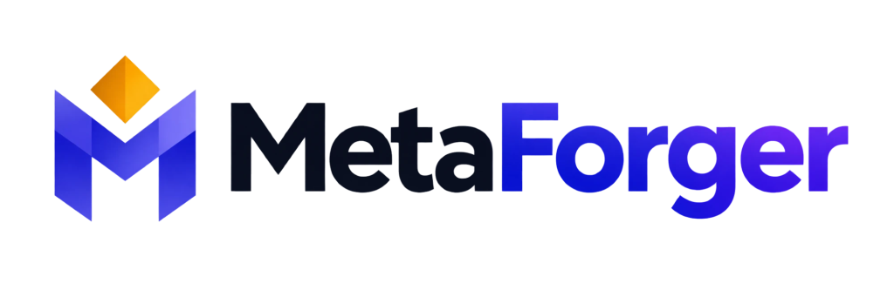
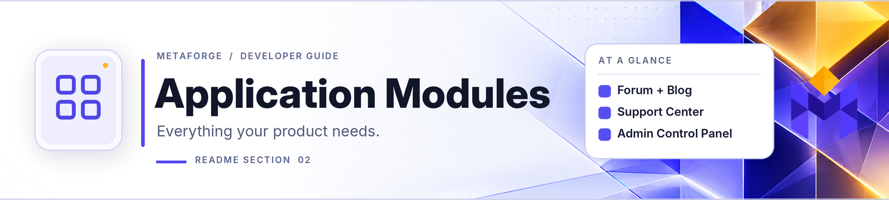
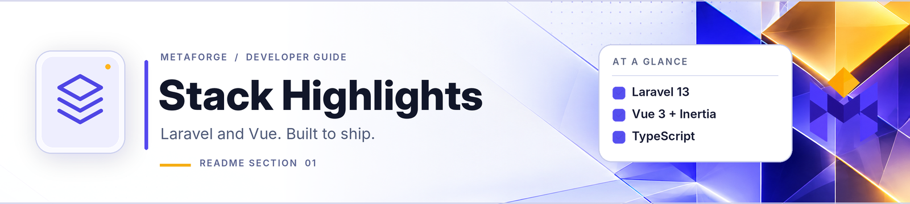
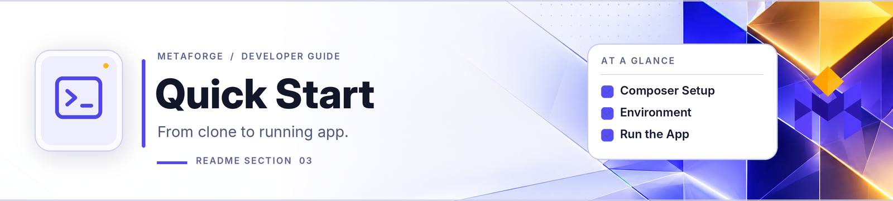
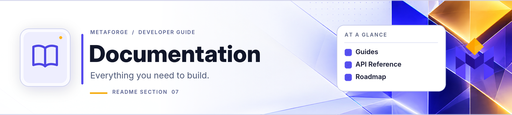
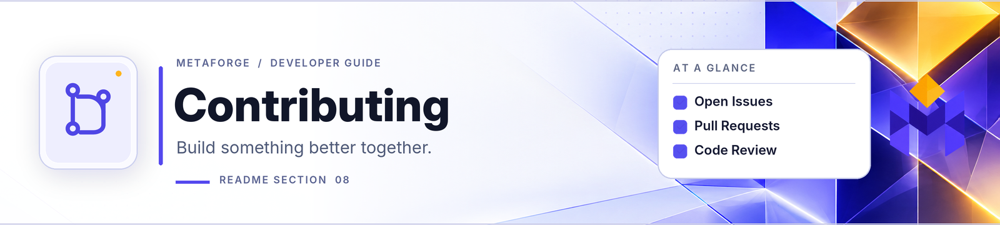

<p align="center">
  <picture>
    <source media="(prefers-color-scheme: dark)" srcset="public/brand/logo-dark.png">
    <source media="(prefers-color-scheme: light)" srcset="public/brand/logo-light.png">
    
  </picture>
</p>

**Project home: [metaforger.dev](https://metaforger.dev)**

A batteries-included boilerplate for building SaaS products, online shops and large community websites with Laravel and Vue. It ships with a forum, a blog, a support desk, a working shop, subscriptions and the admin tooling to run them, so a team can build its own features instead of the scaffolding. Inertia.js keeps the front end and the back end in step, Tailwind CSS powers the design system, and the interface is written in TypeScript.

> **Status: pre-1.0.** The shop works end to end (catalogue, cart, discount codes and gift cards, shipping and tax, Stripe checkout, orders, refunds, digital downloads and licence keys, wishlists and reviews), and subscription plans give entitlements (a feature, a limit). Tebex purchases are a preview that has not been checked against a real store. The road to a stable 1.0.0 is in [docs/ROADMAP-v1.0.0.md](docs/ROADMAP-v1.0.0.md), and each release's changes are in [CHANGELOG.md](CHANGELOG.md).

<h2 id="application-modules">
<picture>
  <source media="(prefers-color-scheme: dark)" srcset="docs/assets/readme/application-modules-dark.png">
  <source media="(prefers-color-scheme: light)" srcset="docs/assets/readme/application-modules-light.png">
  
</picture>
</h2>

- **A shop**: products with variants, a cart, discount codes, gift cards, shipping and tax, Stripe checkout, refunds, digital downloads and licence keys, and wishlists and reviews. Tebex plugs in beside Stripe as a preview ([commerce](docs/commerce.md), [payments](docs/payments.md)).
- **Subscriptions** through Laravel Cashier, with plans that give entitlements, a free trial, promotion codes, dunning emails and a link to Stripe's customer portal ([billing](docs/billing.md)).
- **A community**: a forum with moderation, automatic rules and a review queue, a blog, polls, direct messages, member pages, a leaderboard and a "Get started" checklist.
- **A support desk** with ticket routing, service levels, private attachments and teams ([routing and service levels](docs/support-assignment.md)).
- **An admin area** with roles and permissions, an audit log, read-only "view as" for helping a customer, and switches that turn a whole section of the site off ([features](docs/features.md)).
- **An HTTP API** under `/api/v1` with scoped keys, Swagger UI and an OpenAPI schema ([API](docs/api.md)).
- **Secure and findable by default**: sanitised user content, rate limits, security headers with a nonce-based CSP, two-factor sign-in, sign-in with Google, Discord and Steam, per-page SEO tags, a sitemap and server-side rendering ([security](docs/security.md), [SEO](docs/seo.md)).
- **Ready for production**: a Docker image, a deployment guide for a server or Forge, Redis for the cache, queue and sessions, a bundle-size budget, query budgets, Lighthouse and accessibility checks, and CI on SQLite, MySQL 8 and PostgreSQL 16.
- **Ready for more languages**: English today, with the interface strings, locale selection and a completeness check in place ([adding a language](docs/adding-a-language.md)).

<h2 id="stack-highlights">
<picture>
  <source media="(prefers-color-scheme: dark)" srcset="docs/assets/readme/stack-highlights-dark.png">
  <source media="(prefers-color-scheme: light)" srcset="docs/assets/readme/stack-highlights-light.png">
  
</picture>
</h2>

Built on Laravel 13 (PHP 8.4), Vue 3, Inertia 3, TypeScript, Tailwind CSS 4, shadcn-vue on Reka UI, Tiptap 3, Vite 8, Spatie Permissions and Sanctum. [docs/features.md](docs/features.md) lists every module and the stack in full.

## Prerequisites

- **PHP 8.4+** and **Composer 2**, with these extensions (most are on by default; Herd's PHP has all of them):
  - Required: `bcmath` (used by Cashier's money library), `ctype`, `curl`, `dom`, `fileinfo`, `filter`, `iconv`, `intl` (the list of languages in Settings → Profile), `json`, `libxml`, `mbstring`, `openssl`, `session`, `tokenizer`, `xml`, `xmlwriter` and `zip` (account data exports).
  - A PDO driver for your database: `pdo_sqlite`, `pdo_mysql` or `pdo_pgsql`.
  - `gd` **with WebP support**, for product pictures. Optional: `exif`, so sideways photos are turned upright.
  - `redis` (phpredis) only if you switch cache, queues or sessions to Redis ([docs/redis.md](docs/redis.md)).
- **Node.js 22.13 or newer** (24 LTS recommended, see `.nvmrc`) with **npm 10+**.
- **A database**: SQLite (the default, for local development), **MySQL 8** or **PostgreSQL 16**.
- **For the shop**: a Stripe account (test keys are enough) and, locally, the [Stripe CLI](https://docs.stripe.com/stripe-cli) to forward webhooks.
- Optional: Docker, for the backing services in `compose.yaml` ([docs/development.md](docs/development.md#backing-services-with-docker)) or to run the whole site from the production image ([docs/docker.md](docs/docker.md)).

<h2 id="quick-start">
<picture>
  <source media="(prefers-color-scheme: dark)" srcset="docs/assets/readme/quick-start-dark.png">
  <source media="(prefers-color-scheme: light)" srcset="docs/assets/readme/quick-start-light.png">
  
</picture>
</h2>

```bash
git clone https://github.com/MetaGrenade/laravel-vue.git
cd laravel-vue
composer install
npm install
php artisan metaforger:install
npm run build
composer dev
```

`php artisan metaforger:install` checks that the machine has what the site needs before it changes anything, makes `.env` and the application key, creates the tables (a SQLite file by default), links `public/storage`, adds the roles, support categories and badges, and makes your administrator account. It asks for the site's address (`http://localhost:8000` for `php artisan serve`, or your `.test` address under Herd or Valet) and for the administrator's nickname, email address and password. Run again on a site that is set up, it only runs migrations that are still to run and never empties a table. Add `--demo` for a demo shop, a poll and demo accounts (never on a production site), and `--legal-pages` for a starting text for the terms, privacy and cookie policies. [docs/install.md](docs/install.md) has the options for scripts and CI, doing it by hand, and what to do when it stops. (`composer setup` does the code side first; follow it with `metaforger:install`.)

`composer dev` runs the web server, a queue worker, the scheduler and Vite in one terminal. The queue worker sends the emails and the scheduler runs the timed jobs, so under Herd or Valet, where the web server is already running, start the other three yourself: `php artisan metaforger:queue listen --tries=1`, `php artisan schedule:work` and `npm run dev`. Mail is written to the log until you point `MAIL_*` at a service such as Mailpit.

<h2 id="documentation">
<picture>
  <source media="(prefers-color-scheme: dark)" srcset="docs/assets/readme/documentation-dark.png">
  <source media="(prefers-color-scheme: light)" srcset="docs/assets/readme/documentation-light.png">
  
</picture>
</h2>

Where to go next:

| I want to… | Read |
| --- | --- |
| Work on the code day to day | [docs/development.md](docs/development.md) and [CONTRIBUTING.md](CONTRIBUTING.md) |
| Understand how it is put together | [docs/architecture.md](docs/architecture.md) and [docs/extending.md](docs/extending.md) |
| Put a site on a server | [docs/deployment.md](docs/deployment.md), with every setting in [docs/configuration.md](docs/configuration.md) |
| Run it in Docker | [docs/docker.md](docs/docker.md) |
| Move a running site to a newer version | [docs/upgrading.md](docs/upgrading.md) |
| Take payments | [docs/payments.md](docs/payments.md) for Stripe and Tebex, [docs/commerce.md](docs/commerce.md) for the shop |
| Make it look and read like my own | [docs/theming.md](docs/theming.md) and [docs/adding-a-language.md](docs/adding-a-language.md) |
| See everything there is | [docs/README.md](docs/README.md), the index of every guide, grouped by what you are trying to do |

<h2 id="contributing">
<picture>
  <source media="(prefers-color-scheme: dark)" srcset="docs/assets/readme/contributing-dark.png">
  <source media="(prefers-color-scheme: light)" srcset="docs/assets/readme/contributing-light.png">
  
</picture>
</h2>

Issues and pull requests are welcome. Read [CONTRIBUTING.md](CONTRIBUTING.md) first: it covers setup, the checks every change must pass and how to write code that works on all supported databases. Change the page in `docs/` that explains what you touched, in the same pull request. Report security problems privately, as [SECURITY.md](SECURITY.md) describes.

## License

This project is open-sourced under the [MIT License](LICENSE.md). The software and the assets it is built on keep their own licences, listed in [THIRD-PARTY-NOTICES.md](THIRD-PARTY-NOTICES.md) (see [docs/licences.md](docs/licences.md)).
